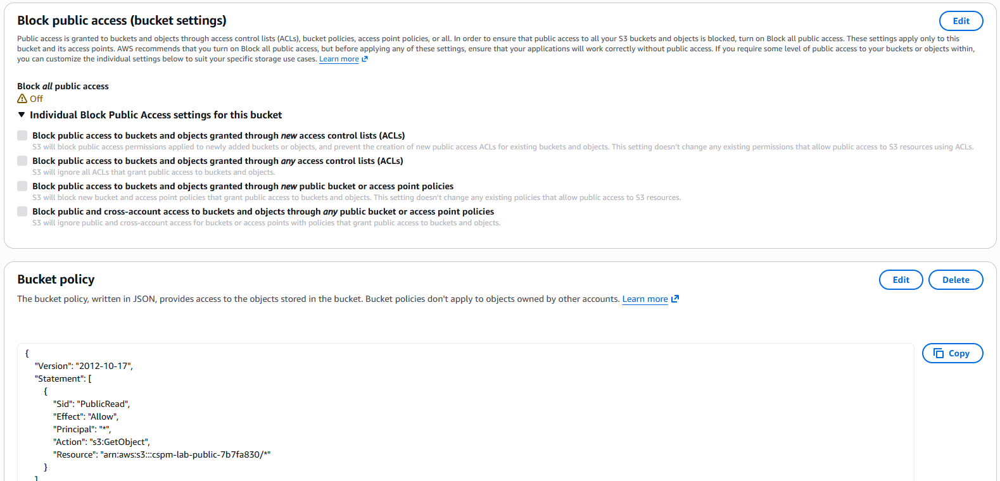
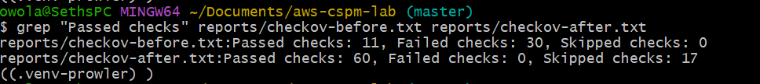
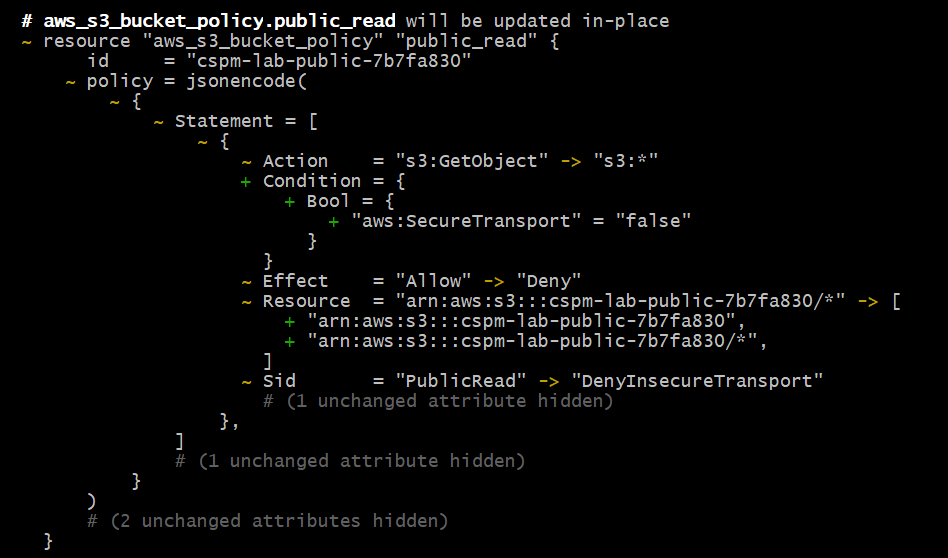
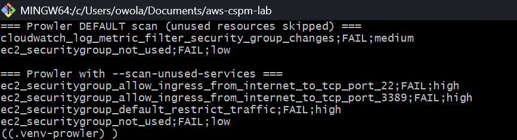
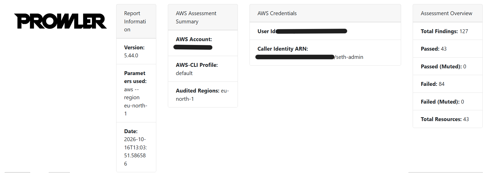
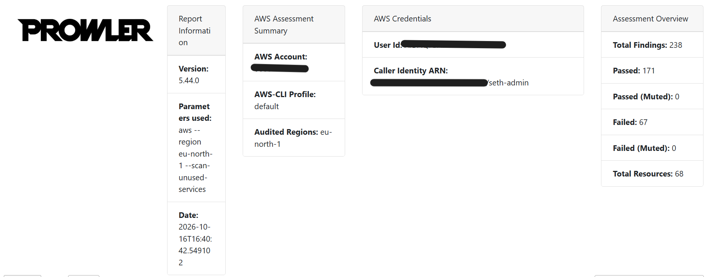
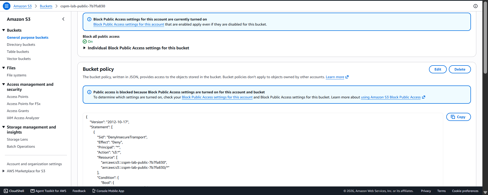
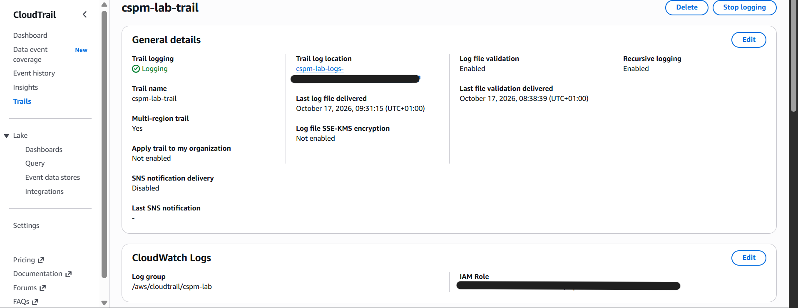
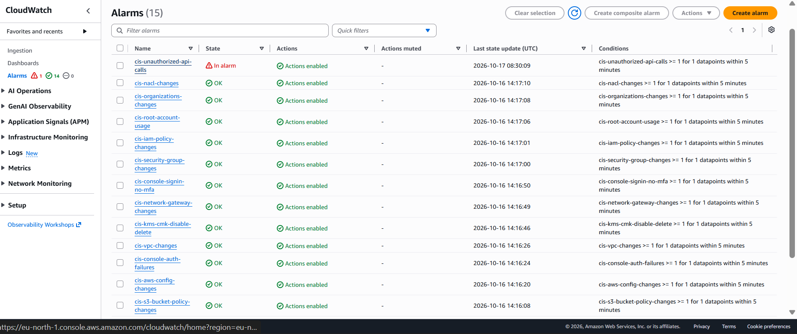
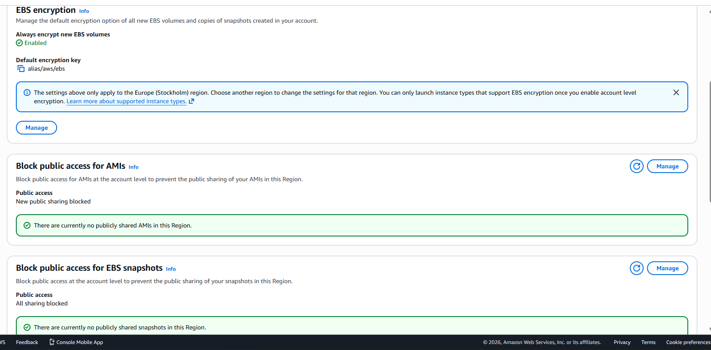

# AWS Cloud Security Posture Lab

**Build it insecure. Detect it two ways. Fix it as code. Prove it's fixed.**

A hands-on cloud security assessment of a real AWS account. I deployed five deliberate misconfigurations with Terraform, detected them with a code scanner (**Checkov**) and a live-account scanner (**Prowler**, CIS AWS Foundations Benchmark), remediated everything as code, and verified each fix in the live account.

📄 **Full write-up:** [`ASSESSMENT-REPORT.md`](ASSESSMENT-REPORT.md)

---

## Results at a glance

| | Before | After |
|---|---|---|
| Checkov failed checks (code) | 30 | **0** |
| Planted misconfigurations open | 5 | **0** |
| CIS CloudWatch security alarms | 0 / 15 | **15 / 15** |
| Prowler Critical findings | 4 | **2** (accepted, documented) |
| Prowler baseline findings resolved | – | **51 of 84** |

Every finding still open is a **documented, accepted risk** with a written reason, both in the report and inline in the Terraform code.

---

## The key finding: neither tool was enough on its own

| Planted misconfiguration | Checkov (code) | Prowler (live, default) | Prowler (live, full scan) |
|---|---|---|---|
| Public S3 bucket | ✅ Caught | ✅ Caught | ✅ Caught |
| IAM user with `*:*` admin policy | ✅ Caught | ✅ Caught | ✅ Caught |
| SSH/RDP open to `0.0.0.0/0` | ✅ Caught | ❌ **Missed** | ✅ Caught |
| Unencrypted EBS volume | ✅ Caught | ✅ Caught | ✅ Caught |
| No CloudTrail audit logging | ❌ **Missed** | ✅ Caught | ✅ Caught |

- **Checkov can't see what isn't there.** CloudTrail was never written in the code, so there was nothing to flag.
- **Prowler skips unused resources by default.** The open security group wasn't attached to anything, so the default scan only called it "unused". With `--scan-unused-services`, ports 22 and 3389 were flagged High.

Code scanning and live scanning cover different blind spots, so a solid assessment uses both.

---

## How it works

```
 ┌─────────────────┐    ┌─────────┐    ┌────────────────┐    ┌──────────────────┐
 │ Terraform       │ -> │ Checkov │ -> │ terraform      │ -> │ Prowler          │
 │ (insecure)      │    │ 30 fail │    │ apply          │    │ 84 fail baseline │
 └─────────────────┘    └─────────┘    └────────────────┘    └────────┬─────────┘
                                                                      │ triage
 ┌─────────────────┐    ┌─────────┐    ┌────────────────┐    ┌────────▼─────────┐
 │ Targeted        │ <- │ Prowler │ <- │ terraform      │ <- │ Terraform        │
 │ re-checks: PASS │    │ full    │    │ apply          │    │ (secure), 0 fail │
 └─────────────────┘    └─────────┘    └────────────────┘    └──────────────────┘
```

1. **Build insecure:** Terraform deploys five planted misconfigurations
2. **Scan code (shift-left):** Checkov flags issues *before* anything is deployed
3. **Scan live:** Prowler checks the real account against the CIS AWS Foundations Benchmark
4. **Triage:** findings grouped by root cause; each marked *remediate* or *accept with reason*
5. **Remediate as code:** the secure `main.tf` replaces the insecure one, and the Git history shows every change
6. **Verify:** rescan with both tools, fix what the deeper scan revealed, re-check

---

## What was fixed

**The five planted issues**
- 🪣 **S3:** Block Public Access on (bucket *and* account level); public-read policy replaced with deny-non-HTTPS; versioning and access logging
- 👤 **IAM:** overprivileged user and `*:*` policy removed
- 🌐 **Network:** SSH/RDP rules removed; VPC default security group stripped of all rules
- 💾 **EBS:** encrypted volume; encryption on by default for the region
- 📜 **CloudTrail:** multi-region trail with log file validation, a locked-down log bucket, streaming to CloudWatch Logs

**Account hardening found only by the live scan**
- **15 CIS alarms** (root usage, console sign-in without MFA, IAM/network/S3/KMS changes, unauthorized API calls, and more), alerting via SNS email
- IAM password policy, IAM Access Analyzer, restricted default network ACL
- IMDSv2 required by default, EBS snapshot public sharing blocked, no automatic public IPs on default subnets
- Confused-deputy protection on the CloudTrail service role

---

## Screenshots

### Before: the bucket was public


### Code scan: 30 failed → 0 failed


### The fix, as reviewed in `terraform plan`


### The detection gap: open ports only visible with `--scan-unused-services`


### Live scan: before and after



### After, in the AWS console
| | |
|---|---|
|  |  |
|  |  |

---

## Tech stack

| Tool | Purpose |
|---|---|
| **Terraform** | Infrastructure as code; provider versions locked with checksums |
| **Checkov** | Static analysis of Terraform before deployment |
| **Prowler** | Live AWS assessment against CIS and 40+ frameworks |
| **AWS** | S3, IAM, EC2/EBS, VPC, CloudTrail, CloudWatch, SNS, Access Analyzer |
| **Git** | Before/after history of every change |

**Security practices used throughout**
- No long-lived access keys: all CLI work used `aws login` short-lived credentials, and an IAM admin user with MFA replaced root
- Secrets and account data kept out of Git (`.gitignore` excludes `*.tfvars`, Terraform state, plan files and raw scan output)
- Accepted risks documented **in the code** with `#checkov:skip=<ID>:<reason>` instead of silently disabled
- Every `terraform apply` ran a saved, reviewed plan file

---

## Lessons learned

1. **Use code and live scanning together.** Each tool missed something the other caught.
2. **Check what was actually scanned.** A clean summary can mean the check never ran.
3. **Finding count isn't risk count.** One missing CloudTrail caused 20 findings.
4. **Read the plan before applying.** It showed a change that would have replaced a security group.
5. **After tightening a permission, verify what depends on it.** I confirmed CloudTrail still delivered logs after locking down its role.
6. **Scanners can be wrong for your context.** Encrypting the alarm topic with AWS's default key, as Checkov suggests, would have silently broken every alert.

More detail in [`ASSESSMENT-REPORT.md`](ASSESSMENT-REPORT.md).

---

## Repository contents

| File | Contents |
|---|---|
| [`ASSESSMENT-REPORT.md`](ASSESSMENT-REPORT.md) | Full assessment: method, results, accepted risks, lessons |
| [`CHECKOV-TRIAGE.md`](CHECKOV-TRIAGE.md) | 30 code findings grouped by root cause |
| [`PROWLER-TRIAGE.md`](PROWLER-TRIAGE.md) | 84 baseline live findings grouped by root cause |
| [`terraform/main.tf`](terraform/main.tf) | Secure configuration (see Git history for the insecure version) |
| `reports/` | Raw Checkov output and screenshots |

## Run it yourself

> ⚠️ The first commit deploys **intentionally insecure** infrastructure. Use a dedicated lab account, never one with real data.

```bash
cd terraform
cp terraform.tfvars.example terraform.tfvars   # set your alert email
terraform init
terraform plan -out=lab.tfplan                 # always review before applying
terraform apply lab.tfplan
terraform destroy                              # when finished
```

---

*Related project: [DevSecOps pipeline for OWASP Juice Shop](https://github.com/naijadevseth/juice-shop) (secrets, SAST and dependency scanning in CI).*
